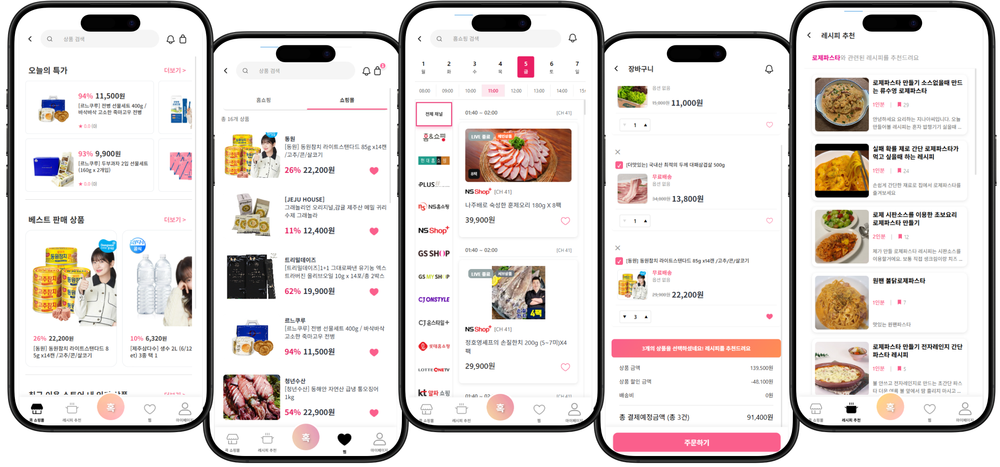
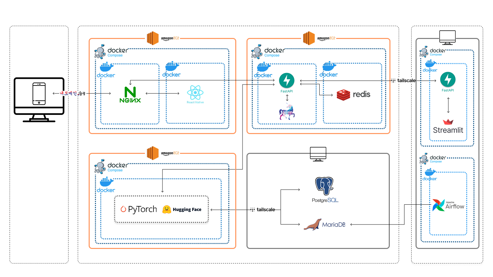
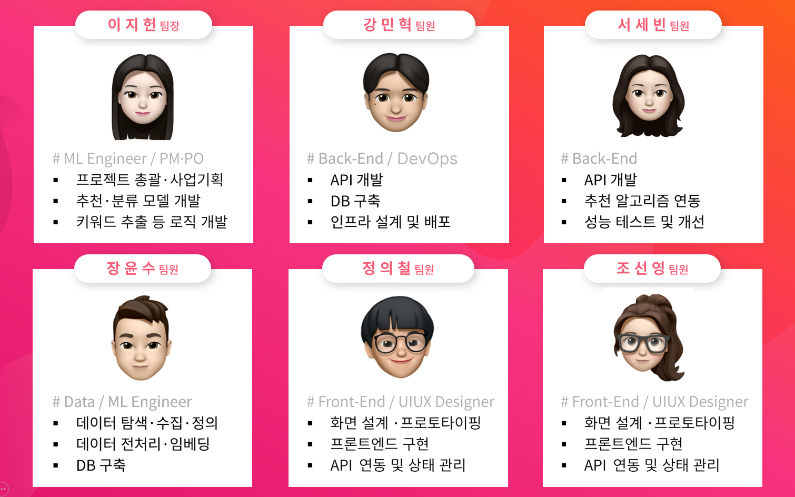

# Eat’s 유혹(Uhok)

[](https://www.youtube.com/watch?v=3ETDQL5bWG0) [-FFD700)](#수상)

## 개요

**Eat's Uhok**은 LG유플러스의 모바일 쇼핑몰 **U+콕**과 U+TV로 방송되는 **홈쇼핑**을 연동해, 사용자 맞춤 식재료 및 레시피를 추천하는 서비스입니다.

| 항목 | 내용 |
| --- | --- |
| 성격 | 실서비스가 아닌 기술 제안용 MVP (AWS 시연 환경 배포) |
| 기간 | 2025.07.23 ~ 09.12 (발표 09.13) |
| 인원 | 6인 [](#팀원-구성) |
| 내 역할 | 백엔드, 결제 서버, ML 추론 서버 연동, 배포 |
| 수상 | 1위 (LG유플러스상) / LGU+ WhyNot SW Camp 6기 최종 프로젝트 경진대회 [](#수상) |



## 내 역할 및 기여

- 백엔드 API 설계 및 구현
- 외부 결제 연동 및 웹훅 수신 서버 구현
- ML 모델 서빙 연동 및 백엔드 추론 API 제공
- MariaDB / PostgreSQL 기반 서비스 DB 설계
- JMeter 기반 성능 테스트 및 성능 개선
- AWS EC2 기반 배포 환경 구성(Docker, Nginx)

| Repo | 한 일 | 상세 |
| --- | --- | --- |
| [uhok-backend](https://github.com/uhoks-sonata/uhok-backend.git) | 프로젝트 백엔드 (FastAPI) | [README](uhok-backend/README.md) |
| [payment-server](https://github.com/khangte/payment-server.git) | 외부 결제 연동 및 웹훅 수신 서버 (FastAPI) | [README](payment-server/README.md) |
| [uhok-ml-inference](https://github.com/uhoks-sonata/uhok-ml-inference.git) | 벡터 임베딩 및 유사도 검색 (추론 API) | [README](uhok-ml-inference/README.md) |
| [uhok-deploy](https://github.com/uhoks-sonata/uhok-deploy.git) | 배포 환경 구성 (AWS EC2/Docker/Nginx) | [README](uhok-deploy/README.md) |

## 주요 문제 해결

### 1. 할인 상품 조회 N+1 쿼리 개선: p95 1,154→218ms

- **문제**: 상품별 최신 가격 조회가 반복되는 1+2N 구조로 p95 1,154ms (목표 500ms 초과)
- **해결**: `MAX(price_id) GROUP BY`로 최신 가격 ID를 집계한 뒤 조인하는 단일 쿼리로 변경, ASC 및 DESC 인덱스 비교 후 ASC 인덱스 적용
- **결과**: p95 1,154 → 218ms, 평균 861 → 144ms, 처리량 22.0 → 104.9 req/s

<details>
<summary>상세 보기</summary>

**문제 정의**

- 상품 목록 조회 후, 상품별로 최신 가격 ID 조회(N회)와 가격 상세 조회(N회)가 추가 발생하는 1+2N 구조로 인한 요청당 DB 호출 수 증가
- 재측정에서 평균 응답 시간 861ms, p95 1,154ms, 최대 1,631ms로 자체 설정 p95 목표 500ms 초과

**해결 과정**

- MariaDB 10.11.13 환경에서 할인율 선별을 위한 `(discount_rate, product_id)`와 최신 가격 조회를 위한 `(product_id, price_id DESC)` 인덱스 사용
- 1차 시도로 `ROW_NUMBER()` 윈도우 함수를 적용해, 상품별 최신 가격 row만 `rn=1`로 선별하는 단일 쿼리로 재구성
- 상품마다 반복하던 최신 가격 ID 조회와 가격 상세 조회를 통합해 DB 호출 2N회 제거
- `EXPLAIN`에서 임시 테이블(`Using temporary`) 사용과 파생 테이블 전체 스캔 확인. 상품별 최신 가격 1건만 필요한 조회에서도 여러 가격 이력에 순번을 매기고 중간 결과를 다시 읽어야 해 처리량 증가
  - 부하 테스트에서 평균 응답 시간 9,546ms 기록
- 2차 시도로 `MAX(price_id) GROUP BY product_id`로 상품별 최신 가격 ID를 먼저 집계하고, 해당 ID로 가격 상세 정보를 조인하는 방식으로 변경

  ```sql
  SELECT p.product_id, ...,
         pr.discount_rate, pr.discounted_price
  FROM product p
  JOIN (
      SELECT product_id, MAX(price_id) AS latest_price_id
      FROM price
      GROUP BY product_id
  ) latest ON p.product_id = latest.product_id
  JOIN price pr ON pr.price_id = latest.latest_price_id
  WHERE pr.discount_rate > 0
  ORDER BY pr.discount_rate DESC
  LIMIT :size OFFSET :offset;
  ```

- 최신 가격 확정 후 할인율 필터를 적용해, 과거 할인 이력이 아닌 현재 할인 중인 상품만 선별
- 변경된 조회에서 사용되지 않는 `(discount_rate, product_id)` 인덱스 제거
- `MAX(price_id) GROUP BY product_id` 쿼리에서 가격 ID의 ASC 및 DESC 인덱스를 비교한 결과, ASC에서 `Using index for group-by` 확인
- 인덱스별 실행 시간 비교: MariaDB 10.11.13에서 워밍업 1회 후 `ANALYZE` 각 3회 중앙값 (단위: ms)

  | 최신 가격 인덱스 | 실행 시간 중앙값 |
  | --- | ---: |
  | `(product_id, price_id ASC)` | **21.42** |
  | `(product_id, price_id DESC)` | 25.69 |

- ASC에서 `Using index for group-by`와 더 짧은 실행 시간을 확인해 `(product_id, price_id ASC)` 인덱스 적용

**결과**

- JMeter 측정에서 초기 N+1 대비 MAX JOIN(ASC)의 평균 응답 시간 861 → 144ms, p95 1,154 → 218ms로 자체 목표 500ms 이내 달성
- 비교 (각 4,000 samples, 오류율 0%)

  | 구분 | 평균 응답 | p95 | 최대 | 처리량 |
  | --- | ---: | ---: | ---: | ---: |
  | 초기 (1+2N) | 861ms | 1,154ms | 1,631ms | 22.0 req/s |
  | 1차 시도 (윈도우 함수) | 9,546ms | 10,922ms | 12,901ms | 2.1 req/s |
  | 2차 시도 (MAX JOIN, DESC) | 198ms | 319ms | 440ms | 82.1 req/s |
  | 2차 시도 (MAX JOIN, ASC) | **144ms** | **218ms** | **373ms** | **104.9 req/s** |

</details>

---

### 2. 결제 상태 폴링을 웹훅으로 전환: 서버 간 호출 최대 31→2회

- **문제**: 5초 간격, 최대 30회 폴링으로 결제 1건당 상태 확인 최대 30회, 결제 완료 후에도 최대 5초 반영 지연
- **해결**: 결제 서버가 결과를 백엔드로 직접 보내는 웹훅 방식으로 전환, `asyncio.Future`로 대기 중인 요청에 즉시 결과 전달
- **결과**: 폴링 주기 지연 제거, 결제 1건당 서버 간 호출 최대 31회 → 2회

<details>
<summary>상세 보기</summary>

**문제 정의**

- "5초 간격 x 최대 30회" 결제 상태 폴링 구조로 결제 1건당 상태 확인 최대 30회 발생
- 폴링 간 고정 대기만 최대 150초 누적되고, 여기에 개별 HTTP 요청 처리 시간이 더해짐
- 폴링 대기 중 결제가 완료되어도 다음 상태 조회까지 반영되지 않아 최대 5초의 추가 대기 발생

**해결 과정**

- 결제 서버가 최종 결과를 백엔드 콜백 URL로 직접 전달하는 웹훅 방식으로 전환하고, 결제 요청마다 트랜잭션 ID를 키로 등록한 `asyncio.Future`를 웹훅 수신 시 즉시 완료시켜 대기 중인 요청에 결과 전달
- 웹훅이 요청 측 구독보다 먼저 도착하는 경우를 대비해 최종 결과를 별도로 캐싱해두어 결과 유실 방지

  ```python
  class WaiterRegistry:
      async def subscribe(self, tx_id):
          fut = asyncio.get_running_loop().create_future()
          if tx_id in self.resolved:  # 웹훅 선도착 시 즉시 완료
              fut.set_result(self.resolved[tx_id])
          else:
              self.waiters.setdefault(tx_id, []).append(fut)
          return fut

      async def resolve(self, tx_id, payload):  # 웹훅 수신 시 호출
          self.resolved[tx_id] = payload
          for fut in self.waiters.pop(tx_id, []):
              if not fut.done():  # 타임아웃으로 취소된 Future 제외
                  fut.set_result(payload)
          ...

  # 결제 요청 측
  fut = await webhook_waiters.subscribe(tx_id)
  result = await asyncio.wait_for(fut, timeout=60)
  ```

- 결제 서버의 웹훅 재시도가 백엔드의 60초 대기 이후까지 이어질 수 있어, 대기 타임아웃 시 주문을 결제 요청 상태로 유지하고 늦게 도착한 웹훅으로 최종 상태 확정
- 재시도까지 모두 실패해 웹훅이 영구 유실되는 경우에 대비해, 5분 이상 결제 대기 상태로 남은 주문을 다음 결제 시도 시점에 감지해 자동 취소

**결과**

- 웹훅 수신 즉시 상태가 반영되어 최대 5초의 폴링 주기 지연 제거
- 웹훅이 재시도 없이 1회에 성공하는 정상 케이스 기준, 결제 1건당 백엔드-결제 서버 간 총 호출이 최대 31회(결제 생성 1 + 상태 확인 30)에서 **2회**(결제 생성 1 + 웹훅 수신 1)로 줄어 최대 약 **93.5%** 감소

</details>

---

### 3. ML 서비스 분리: 백엔드 이미지 9.98GB→596MB

- **문제**: 백엔드 이미지에 ML 의존성이 포함돼 9.98GB, 동기 임베딩 연산이 이벤트 루프를 점유해 다른 API 블로킹 위험
- **해결**: 임베딩 및 유사도 검색을 별도 EC2의 ML 서비스로 분리하고 비동기 HTTP로 호출, 멀티스테이지 빌드 적용
- **결과**: 이벤트 루프 블로킹 요인 제거, 백엔드 이미지 9.98GB → 596MB, ML 이미지 9.43GB → 1.91GB

<details>
<summary>상세 보기</summary>

**문제 정의**

- 백엔드 이미지에 `torch`, `sentence-transformers` 등 ML 의존성이 함께 포함돼 이미지 크기가 9.98GB에 달하고 빌드에도 오랜 시간 소요
- 단일 Uvicorn 프로세스에서 추천 API의 `SentenceTransformer.encode()` 동기 호출이 이벤트 루프를 점유해, 연산이 끝날 때까지 같은 이벤트 루프의 다른 요청 처리가 지연될 수 있는 구조

**해결 과정**

- 백엔드 이미지에서 ML 의존성을 제거하고 동기 임베딩 연산의 이벤트 루프 블로킹을 해소하기 위해 ML 서비스 분리 결정
- 추천 연산과 일반 API의 CPU 및 메모리 자원 경합 가능성도 고려해 별도 EC2 인스턴스에 배포
- 임베딩 생성 로직을 ML 서비스로 옮기고 백엔드의 동기 `encode()` 호출을 비동기 HTTP 요청으로 교체해, 백엔드에서 `torch`, `sentence-transformers` 의존성 제거
- ML 서비스는 모델을 CPU로 실행하도록 설정하고, `torch` 설치 시 CPU 휠 인덱스를 추가
- 이미지에 남은 빌드 도구를 제외하기 위해 멀티스테이지 빌드를 적용하고, 실행 이미지에는 빌더에 설치한 의존성만 복사
- Nginx로 외부 요청 진입점을 통합하고, 백엔드와 ML 서비스는 프라이빗 IP로 통신하도록 구성
- 이후 백엔드에 남아 있던 `pgvector` 벡터 유사도 검색도 ML 서비스로 이전해, 백엔드는 검색된 레시피 ID와 거리 값을 응답받도록 변경

**결과**

- 백엔드의 동기 임베딩 호출을 비동기 HTTP 요청으로 대체해, 임베딩 연산에 의한 이벤트 루프 블로킹과 모델의 백엔드 메모리 점유 제거
- 백엔드 이미지 9.98GB(torch GPU 포함) → 981MB(ML 컨테이너 분리 후 torch 제거) → **596MB**(멀티스테이지 빌드 적용)
- ML 추론 서비스 이미지 9.43GB → **1.91GB**

</details>

## 아키텍처

### 시스템 아키텍처



### 클라우드 아키텍처


## 기술 스택

#### 백엔드

    

#### 대시보드


#### 데이터베이스

  

#### 배포

  

## 주요 기능

### 주문 및 결제 *(담당: 주문, 결제 API 및 결제 서버, 웹훅 연동 구현)*

- **U+콕 주문 및 결제**: 상품 상세에서 바로 주문하거나 장바구니에서 선택 주문, 모의 결제 서버의 웹훅을 통한 결제 완료·취소 처리
- **홈쇼핑 주문**: 방송 상품 상세에서 전화·모바일 주문 옵션을 제공하며, 두 옵션 모두 앱 내에서 주문을 생성
- **주문 상태 관리**: 주문 상태(결제완료→상품준비중→배송중→배송완료) 자동 변경, 주문 내역 및 최근 주문 조회

### 회원 및 알림 *(담당: 사용자 인증, 로그 API 구현)*

- **회원**: 회원가입(이메일 중복 확인), 로그인, 로그아웃, 마이페이지 회원 정보 조회
- **알림**: 홈쇼핑 상품 찜 시 방송 시작 예정 알림과 홈쇼핑 주문 상태 변경 알림을 저장하고, 알림 목록 조회와 읽음 처리 제공. U+콕 주문 알림(결제완료·배송중·배송완료)은 주문 상태 이력에서 조회
- **사용자 로그**: 사용자 활동 및 이벤트 로그 수집

### 쇼핑

- **U+콕 쇼핑몰**: 오늘의 특가(할인 상품), 베스트 판매 상품, 구매한 스토어의 베스트 상품, 상품 상세 및 리뷰, 판매자 정보 조회
- **홈쇼핑 편성표**: 날짜별 방송 편성 및 방송 상품 상세 조회, 스트림이 제공되는 방송의 라이브 재생
- **상품 매칭**: 홈쇼핑 방송 상품과 유사한 U+콕 상품 추천, U+콕 상품과 관련된 홈쇼핑 방송 추천
- **상품 검색**: 홈쇼핑 방송 상품과 U+콕 상품 키워드 검색, 검색 기록 저장·조회·삭제
- **찜 및 장바구니**: U+콕·홈쇼핑 상품 찜 및 목록 조회, U+콕 장바구니 상품 담기·수량 변경·삭제

### 레시피

- **레시피 검색**: 레시피명 및 키워드 입력 시 임베딩 유사도 기반 검색, 식재료명 검색 *(담당: 임베딩 유사도 검색 로직 이식 및 ML 추론 서버 분리 연동)*
- **보유 재료 기반 추천**: 식재료를 3개 이상 입력하면 보유 재료를 활용하는 레시피를 최대 3개 조합으로 추천하며, 후속 조합에서는 앞서 추천한 레시피를 제외
- **상품 기반 추천**: 장바구니에서 선택한 상품이나 식재료로 분류된 홈쇼핑 방송 상품의 상품명에서 식재료 키워드를 추출해 레시피 추천
- **레시피 상세**: 최근 7일간의 취소되지 않은 U+콕·홈쇼핑 주문과 U+콕 장바구니를 기준으로 재료별 보유·장바구니·미보유 상태 표시. 미보유 재료의 U+콕·홈쇼핑 상품 추천 및 상품 상세 연결, 레시피 원문 열기, 별점 등록 및 조회

## 한계

- **로그 처리**: 로그 수집은 구현했지만, 수집한 로그를 분석하고 활용하는 처리 단계는 구현하지 못함
- **푸시 알림**: 알림 데이터를 DB에 적재하는 데까지만 구현했고, 사용자에게 실제로 보내는 푸시 알림은 구현하지 못함
- **DB 배포**: DB를 클라우드에 배포하지 않고 데스크탑 한 대에 띄워 운영함
- **자동화 부족**: 배포를 수동으로 진행함
- **보안**: AWS 보안 설정은 최소한으로만 적용했고, 서버 간 통신 보안까지는 충분히 신경 쓰지 못함

## 팀원 구성



## 수상

> **1위 (LG유플러스상)** / LGU+ WhyNot SW Camp 6기 최종 프로젝트 경진대회 (2025.09.13)


