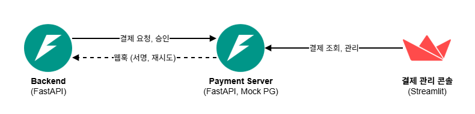

# Payment Server

## 원본 Repo

👉 https://github.com/khangte/payment-server.git

## 개요

이 레포는 프로젝트의 **결제 서버**(Mock PG) 입니다.

## 내가 한 일

- 결제 요청, 승인 API 구현
- 결제 결과를 백엔드로 전달하는 웹훅 전송 구현 (서명, 재시도)
- Streamlit 결제 관리 콘솔 구현

## 아키텍처

## 담당자

- **강민혁**
