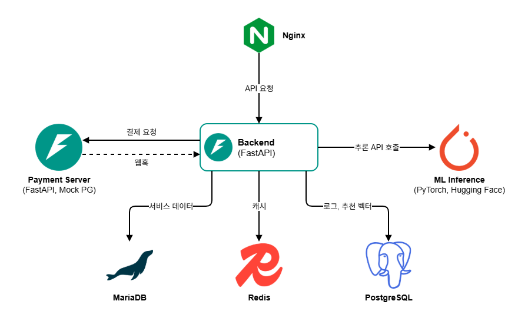
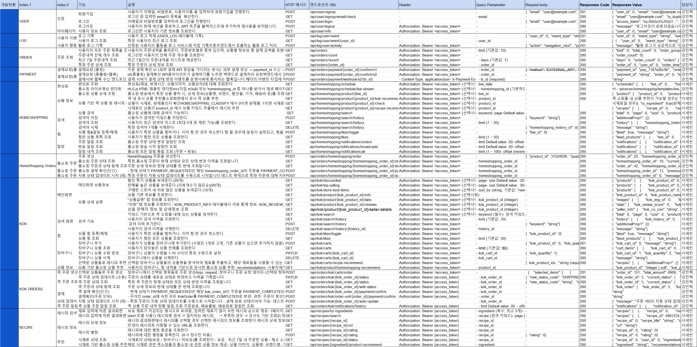
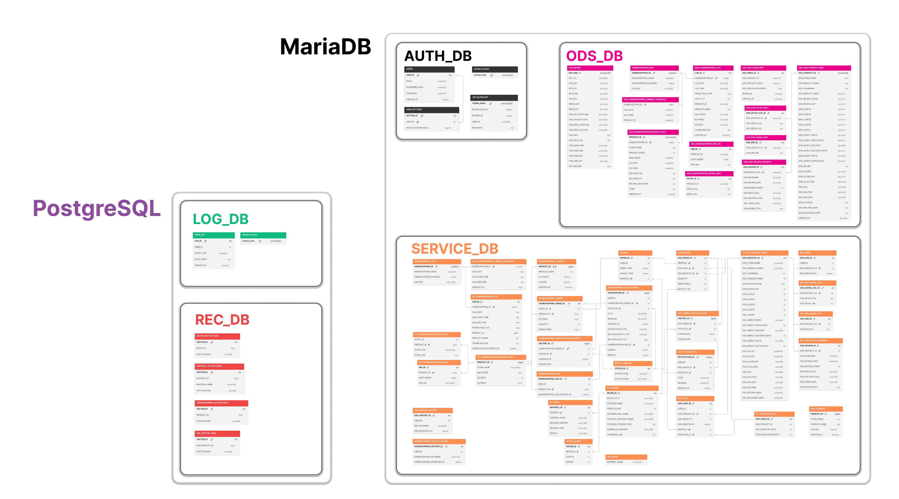

# Uhok Backend

## 원본 Repo

👉 https://github.com/uhoks-sonata/uhok-backend.git

## 개요

이 레포는 프로젝트의 **백엔드 서버**(FastAPI) 입니다.

## 내가 한 일

- 사용자 인증, 로그 API 구현
- 주문, 결제 API 구현 및 결제 서버([payment-server](../payment-server)) 웹훅 연동
- ML 유사도 검색 로직 이식 및 [uhok-ml-inference](../uhok-ml-inference)로 분리 연동
- MariaDB(서비스 데이터) / PostgreSQL(로그, 추천 벡터) DB 설계
- JMeter 기반 성능 테스트 및 성능 개선

## 아키텍처

## 문서

- [API 명세서](../docs/API%20명세서.xlsx)

  

- [테이블 정의서](../docs/테이블%20정의서%20수정%20버전.xlsx)

  

- [성능평가 결과보고서](../docs/05%20성능%20평가%20결과서.pdf)

## 담당자

- **강민혁**: 주문, 결제, 사용자 인증, 로그, 공통 모듈
- **서세빈**: 홈쇼핑, 콕, 레시피 API 및 쿼리 최적화
