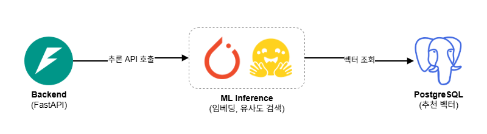

# Uhok ML Inference

## 원본 Repo

👉 https://github.com/uhoks-sonata/uhok-ml-inference.git

## 개요

이 레포는 프로젝트의 **벡터 임베딩 & 유사도 검색 추론 서버** 입니다.

유사도 검색 로직은 [uhok-ml-developer](https://github.com/uhoks-sonata/uhok-ml-development.git)에서 팀원이 개발했습니다. 저는 이 로직을 [uhok-backend](https://github.com/uhoks-sonata/uhok-backend.git)에 이식한 뒤, 추론 로직을 **별도 서비스로 분리**했습니다.

## 내가 한 일

1. **백엔드 이식**: `uhok-ml-developer`의 유사도 검색 로직을 `uhok-backend`에 통합해 서비스에서 동작하도록 연동
2. **추론 로직 분리**: 백엔드 내부의 모델 로딩/임베딩/유사도 검색 로직을 독립된 추론 서버(`uhok-ml-inference`)로 분리하고, 백엔드는 API로 호출하도록 변경

## 아키텍처

## 담당자

- **강민혁**
